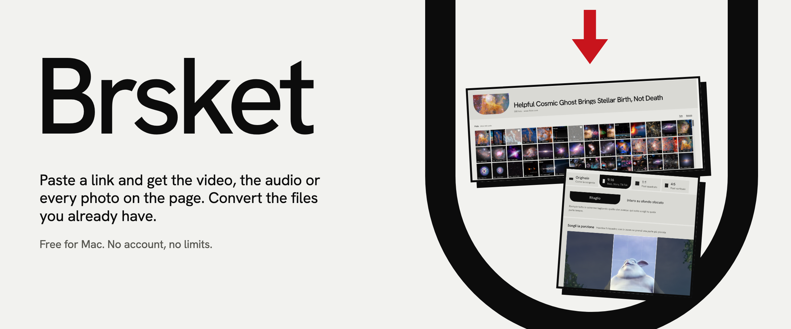
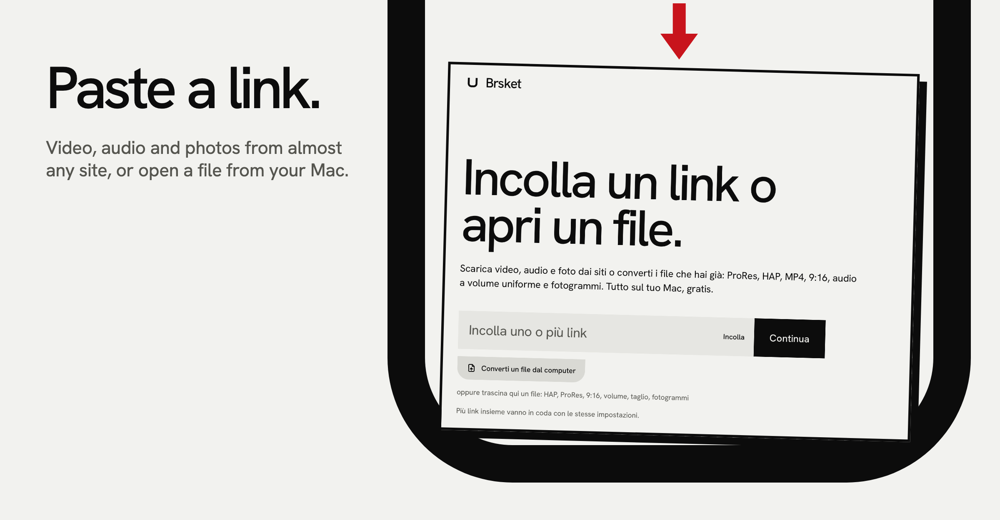
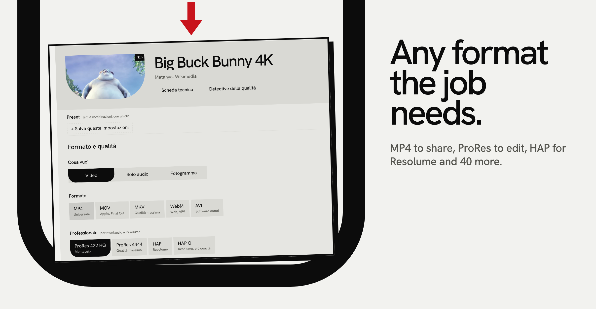
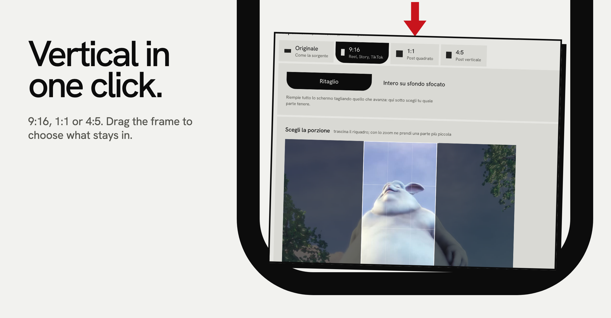
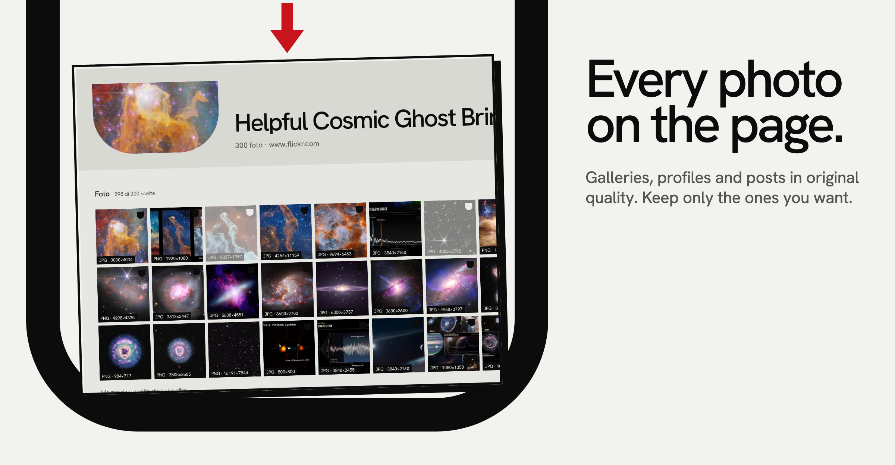
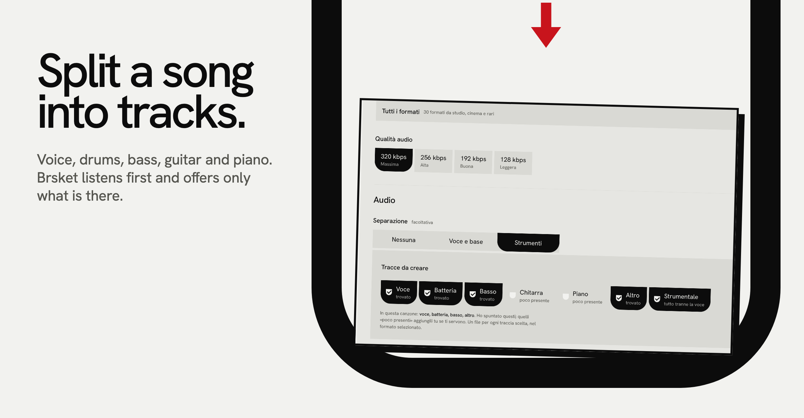
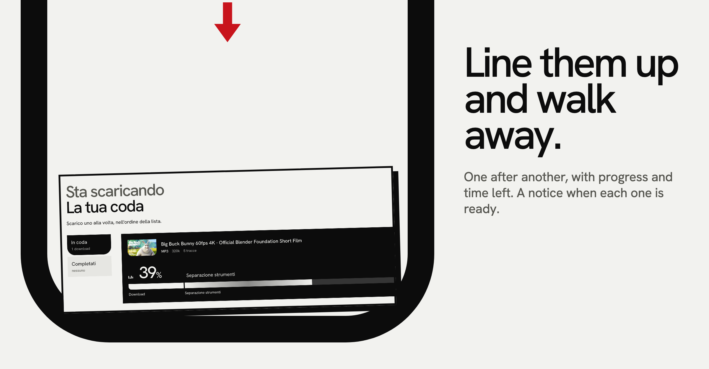

  

<h1 align="center">Brsket</h1>

  <b>Incolla un link. Ottieni il file.</b> 
  Un'app gratuita per Mac che scarica video, audio e foto dal web 
  e converte i file che hai già, da MP4 a ProRes e HAP.

  
  
  
  

  <a href="../../releases/latest"><b>Scarica per Mac</b></a> ·
  <a href="#cosa-fa">Cosa fa</a> ·
  <a href="#funzioni">Funzioni</a> ·
  <a href="#installazione">Installazione</a> ·
  <a href="#privacy-e-sicurezza">Privacy</a> ·
  <a href="README.md">English</a>

---

## Cosa fa

Brsket ha un solo campo. Incolli un link e scegli cosa prendere, oppure trascini un file del Mac e scegli cosa deve diventare. Tutto avviene sul tuo Mac: niente account, niente caricamenti sui server di qualcuno, nessun limite giornaliero e niente da pagare.

## Funzioni

### Scarica dai link
- **Video e audio** dai siti supportati da [yt-dlp](https://github.com/yt-dlp/yt-dlp), fino alla qualità migliore che il sito offre.
- **Foto** da pagine, gallerie e profili con [gallery-dl](https://github.com/mikf/gallery-dl), o da qualunque pagina web. Le vedi in una griglia e tieni solo quelle che vuoi.
- **Playlist intere**, o più link insieme con le stesse impostazioni.
- **Accesso ai siti** da una finestra dentro Brsket, quando un video o una foto richiedono il tuo account. La password va al sito: Brsket non la legge e non la salva.

### Converti
- **Formati di tutti i giorni**: MP4, MOV, MKV, WebM, AVI, MP3, M4A, ALAC, FLAC, WAV, Opus, OGG.
- **Formati professionali**: ProRes 422 HQ, ProRes 4444, HAP, HAP Q, più decine di formati broadcast, web, storici e sequenze di immagini.
- **4K, misure su misura** per ledwall e schermi, e frame rate da 24 a 60.
- **Più veloce sui chip Apple**: H.264, HEVC e ProRes usano il motore multimediale del Mac quando possono.

### Modifica prima di salvare
- **9:16, 1:1 e 4:5**, con il ritaglio dove vuoi tu o interi su sfondo sfocato.
- **Taglio** con l'anteprima esatta del tratto scelto.
- **Fotogrammi e copertine** salvati come immagini.
- **Volume uniforme** a −14, −16 o −23 LUFS, e audio mono, stereo, 5.1 o 7.1.

### Separa la musica
- **Voce e base** in due file.
- **Strumenti separati**: voce, batteria, basso, chitarra, piano, altro e strumentale. Brsket ascolta prima la canzone, propone solo quello che c'è e non salva tracce vuote.

### Capisci un file
- **Scheda tecnica** di un file o di un link, con una sezione di colorimetria per color grading e montaggio.
- **Detective della qualità**: trova cosa abbassa la qualità di un video, come bitrate basso, ingrandimenti, fotogrammi ripetuti o audio saturato, e te lo spiega.

### Resta in ordine
- **Coda** con avanzamento e tempo rimanente, notifica quando un lavoro è pronto e possibilità di riprovare.
- **Preset** per le impostazioni che usi spesso e nomi dei file come li vuoi tu.
- **Dal telefono**: sulla stessa rete Wi-Fi inquadri un codice e mandi i link al Mac. Resta spento finché non lo attivi.

## Installazione

**Requisiti:** un Mac con chip Apple (M1 o successivi) e macOS 13 o successivo. Il download pesa circa 300 MB; installata, Brsket occupa circa 1,1 GB perché i modelli per la separazione sono dentro l'app.

1. Scarica **Brsket-10.0.dmg** dalle [Release](../../releases/latest).
2. Aprilo e trascina **Brsket** in **Applicazioni**.
3. Apri Brsket. La prima volta macOS dice che non può verificare lo sviluppatore, perché Brsket è distribuita fuori dall'App Store e non è notarizzata. Premi **Fine**, apri **Impostazioni di Sistema › Privacy e sicurezza**, scorri in basso e premi **Apri comunque** accanto a Brsket.
4. Se macOS chiede se Brsket può accedere alla cartella **Download**, premi **Consenti**. I file finiscono in **Download › Brsket**.

I siti cambiano spesso. Se un link smette di funzionare, controlla nelle [Release](../../releases/latest) se c'è una versione nuova: Brsket non si aggiorna da sola.

## Privacy e sicurezza

- **Niente account, statistiche o tracciamento.** Brsket contatta solo i siti che le indichi e quelli in cui scegli di accedere.
- **App Sandbox attiva**, per l'app e per gli strumenti che avvia.
- **Il motore locale risponde solo alla finestra di Brsket**, con una chiave creata a ogni avvio. Le richieste di pagine web e altre app vengono rifiutate.
- **I link scelti da una pagina web non possono raggiungere il tuo Mac o la rete di casa** quando Brsket scarica le foto.
- **L'accesso dal telefono è spento di partenza** e richiede un codice.

Altri dettagli in [SECURITY.md](SECURITY.md) e nella [privacy policy](https://papagnidavide22-lang.github.io/brsket-site/privacy.html).

## Usala con responsabilità

Scarica solo contenuti tuoi, liberi da diritti o per cui hai il permesso. Molti siti, YouTube compreso, limitano il download nelle loro condizioni. I video protetti da DRM non sono supportati.

## Segnalazioni

Hai trovato un problema o hai un'idea? [Apri una segnalazione](../../issues/new/choose). Sono utili la versione di Brsket, quella di macOS e il link interessato.

## Licenza

Brsket si scarica e si usa gratis. Tutti i diritti riservati: vedi [LICENSE](LICENSE). Include strumenti open source con le loro licenze: vedi [THIRD_PARTY_NOTICES.md](THIRD_PARTY_NOTICES.md).

Immagini negli screenshot: <i>Big Buck Bunny</i> © Blender Foundation (CC BY 3.0); foto spaziali dall'account Flickr del telescopio Webb della NASA (NASA, ESA, CSA, STScI).
