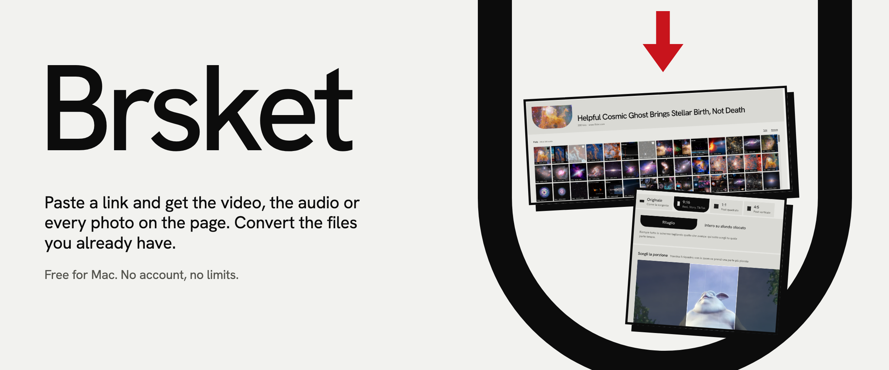
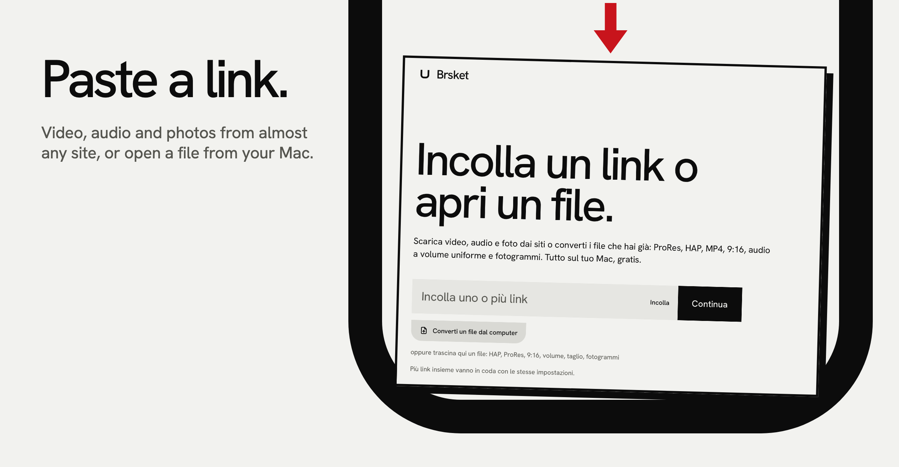
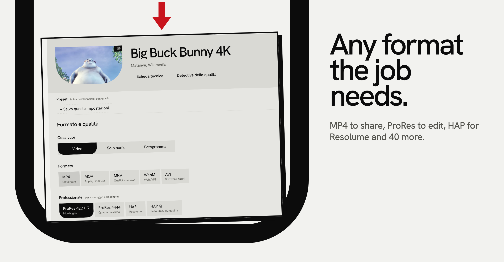
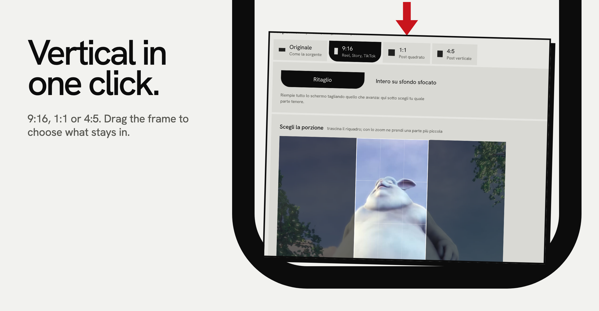
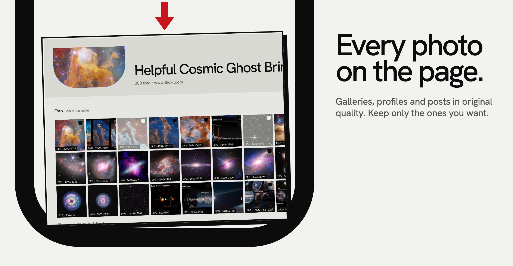
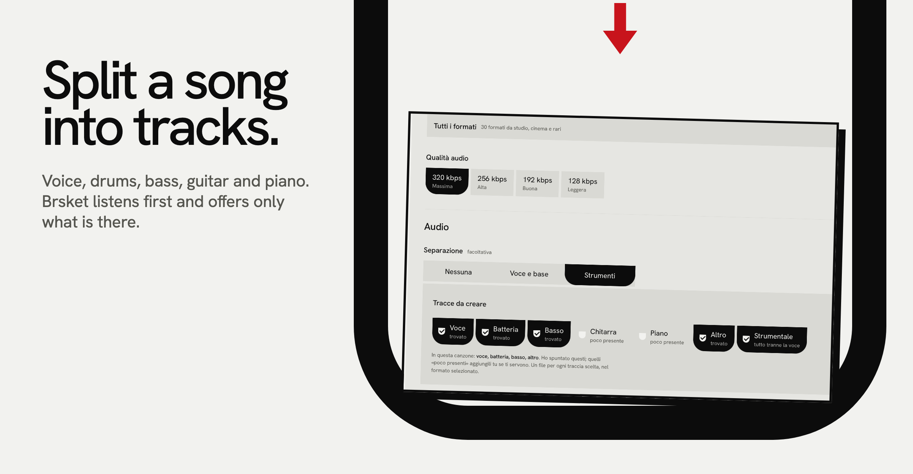
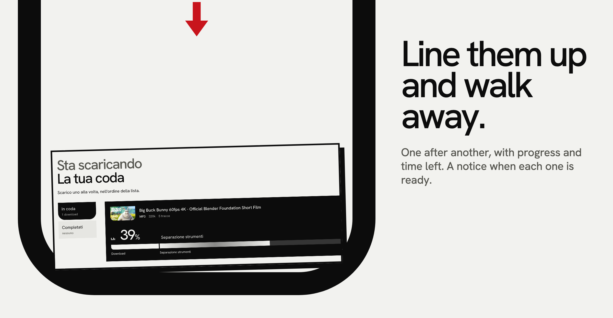

  

<h1 align="center">Brsket</h1>

  <b>Paste a link. Get the file.</b> 
  A free Mac app that downloads video, audio and photos from the web 
  and converts the files you already have, from MP4 to ProRes and HAP.

  
  
  
  

  <a href="../../releases/latest"><b>Download for Mac</b></a> ·
  <a href="#what-it-does">What it does</a> ·
  <a href="#features">Features</a> ·
  <a href="#install">Install</a> ·
  <a href="#privacy-and-security">Privacy</a> ·
  <a href="README.it.md">Italiano</a>

---

## What it does

Brsket has one field. Paste a link and choose what you want from it, or drop in a file from your Mac and choose what it should become. Everything runs on your Mac: no account, no upload to anyone's server, no daily limit and nothing to pay.

> The app's interface is in Italian. This page and the release notes are in English and Italian.

## Features

### Download from links
- **Video and audio** from the sites supported by [yt-dlp](https://github.com/yt-dlp/yt-dlp), up to the best quality the site offers.
- **Photos** from pages, galleries and profiles with [gallery-dl](https://github.com/mikf/gallery-dl), or from any web page. See them in a grid and keep only the ones you want.
- **Whole playlists**, or several links at once with the same settings.
- **Sign in to a site** from a window inside Brsket when a video or a photo needs your account. Your password goes to the site; Brsket never reads or stores it.

### Convert
- **Everyday formats**: MP4, MOV, MKV, WebM, AVI, MP3, M4A, ALAC, FLAC, WAV, Opus, OGG.
- **Professional formats**: ProRes 422 HQ, ProRes 4444, HAP, HAP Q, plus dozens of broadcast, web and legacy formats and image sequences.
- **4K, custom sizes** for LED walls and screens, and frame rates from 24 to 60.
- **Faster on Apple silicon**: H.264, HEVC and ProRes use the Mac's media engine when they can.

### Edit before you save
- **9:16, 1:1 and 4:5**, cropped where you choose or fitted over a blurred background.
- **Trim** with a preview of the exact part you picked.
- **Frames and covers** saved as images.
- **Even loudness** at −14, −16 or −23 LUFS, and mono, stereo, 5.1 or 7.1 audio.

### Split music
- **Voice and backing track** in two files.
- **Separate instruments**: voice, drums, bass, guitar, piano, other and instrumental. Brsket listens to the song first and suggests only what is there, and it doesn't save empty tracks.

### Understand a file
- **Spec sheet** for a file or a link, including a colorimetry section for grading and editing.
- **Quality detective**: finds what is lowering a video's quality, such as low bitrate, upscaling, repeated frames or clipped audio, and explains it.

### Stay organised
- **Queue** with progress and time left, a notification when a job is ready, and retry.
- **Presets** for the settings you use often, and file names built the way you want.
- **From your phone**: on the same Wi-Fi, scan a code and send links to your Mac. It is off until you turn it on.

## Install

**Requirements:** a Mac with Apple silicon (M1 or later) and macOS 13 or later. The download is about 300 MB; installed, Brsket takes about 1.1 GB because the separation models are inside the app.

1. Download **Brsket-10.0.dmg** from [Releases](../../releases/latest).
2. Open it and drag **Brsket** into **Applications**.
3. Open Brsket. The first time, macOS says it can't verify the developer, because Brsket is distributed outside the App Store and is not notarized. Press **Done**, open **System Settings › Privacy & Security**, scroll down and press **Open Anyway** next to Brsket.
4. If macOS asks whether Brsket can access your **Downloads** folder, press **Allow**. Your files are saved in **Downloads › Brsket**.

Websites change often. If a link stops working, check [Releases](../../releases/latest) for a newer version: Brsket doesn't update itself.

## Privacy and security

- **No account, no analytics, no tracking.** Brsket contacts only the sites you give it and the sites you choose to sign in to.
- **App Sandbox on**, for the app and for the tools it runs.
- **The local engine answers only to Brsket's own window**, through a key created at each launch. Requests from web pages and other apps are refused.
- **Links chosen by a web page can't reach your Mac or home network** when Brsket downloads photos.
- **Phone access is off by default** and needs a code.

More in [SECURITY.md](SECURITY.md) and in the [privacy policy](https://papagnidavide22-lang.github.io/brsket-site/privacy.html).

## Use it responsibly

Download only content that is yours, that is free to use, or that you have permission to download. Many sites, YouTube included, restrict downloading in their terms. DRM-protected videos are not supported.

## Feedback

Found a bug or have an idea? [Open an issue](../../issues/new/choose). The Brsket version, your macOS version and the link involved help most.

## License

Brsket is free to download and use. All rights reserved: see [LICENSE](LICENSE). It includes open-source tools under their own licenses: see [THIRD_PARTY_NOTICES.md](THIRD_PARTY_NOTICES.md).

Images in the screenshots: <i>Big Buck Bunny</i> © Blender Foundation (CC BY 3.0); space photos from NASA's Webb Telescope account on Flickr (NASA, ESA, CSA, STScI).
